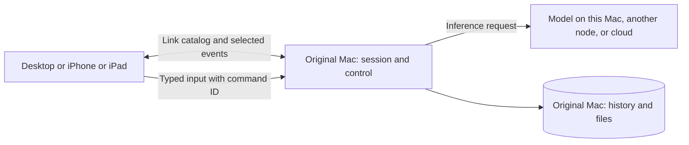

# Goose sessions across devices and iOS remote control

The product should expose one view of the user's work across their Link machines. A session continues to execute on the Mac that owns it; any authorized desktop, iPhone or iPad can read it and send supported input to that same execution. A model-serving machine is a separate concept from the Mac owning the session. The mobile app is a controller and is never offered as compute capacity.

This is the architecture and implementation plan requested on 26 October 2026. The follow-up authorized feasibility work using virtual devices; production Goose behavior and the mobile product remain unimplemented. The source audit used remote `e79a6f60ec`, independently verified against GitHub at the start; the laptop checkout was five local documentation commits ahead and 216 commits behind. The clean `codex/link-controller-plan` worktree preserves that unrelated local work.

## What exists today

The September notes explicitly anticipated an iOS companion and described session mirroring as read-only v1. Current code supplies node/session indexes, WebSocket events, remote execution, model operations and, on current main, shell/prompt jobs and measured host resources. There is no native iOS scaffold or end-to-end fleet session viewer/controller in the inspected tree. Historical upstream mobile/tunnel documentation is not the LeanZero implementation; newer docs say the old tunnel was removed.

Several existing boundaries matter to this design:

- Session IDs are generated within each local database. Two Macs can legitimately have the same ID. Some existing mirrors key only by that ID and some deltas omit the owner.
- The desktop loads sessions through its local ACP connection. Loading a session also activates a local agent, so it cannot be reused unchanged to view a remote transcript.
- Steering uses the originating connection's active run. Another window currently sees a busy state without the full streamed answer. A remote input needs a shared owner-side control service.
- Current event replay is in memory and resets after restart. A long phone suspension can exceed replay retention. A session-summary refresh cannot reconstruct lost transcript bytes.
- Agent Work, benchmarks and shell jobs use different stores and controls. Some benchmarks accept a note at the next task boundary; a normal shell process has no agent to interpret a message.
- Current Link authentication shares an account-level node secret. It is not individually revocable controller authorization. Early notes describing an email-derived token are superseded and must not be implemented.

These are source findings, not claims that a particular installed binary was exercised. Exact implementation anchors are in [the evidence map](link-remote-control-evidence.md).

## Product scope and navigation

Desktop gains an **All machines** view of Sessions, with a machine filter and clear owner on every row. Mobile opens to the same work catalog. Both show the latest meaningful event, state, pending input, last contact and origin machine. Opening work fetches its history and follows live updates from its owner.

The mobile app has three destinations: **Sessions**, **Nodes**, and **Settings**. Session kinds distinguish Chat, Agent Work, Benchmark and Shell job. Developer chat is a chat capability, not a new incompatible storage type. A remote prompt job links to its chat; it does not appear twice as unrelated work. Internal subagents are nested under their parent rather than flooding the default list.

Nodes shows physical machines, with their model-serving and job capacities, current inference requests and running jobs. Resource consumption by a model server does not masquerade as a user session. Controllers appear separately under Connected devices; they have no “idle worker” state, inference slots, or schedulable job capacity.

The requested mobile management features remain focused: choose a Mac and request a Hugging Face download; configure a provider on that Mac; enroll/manage a node; inspect resources; manually synchronize fleet state. No mobile model execution, code editor, general desktop streaming, terminal emulator or migration of running sessions is required. No new arbitrary shell-job launcher is necessary for the mobile scope.

## Ownership and capabilities

Use a common work identity: `WorkRef { owner_node_id, kind, work_id }`, where `work_id` is a durable, never-reused object UUID. Retain the existing chat session ID, benchmark run/slot or job ID as an adapter locator, not the public command identity. Current chat IDs use the maximum existing daily counter: deleting the latest row and creating another can reuse an ID on the same Mac. Backfill existing objects transactionally; every new/replaced object receives a fresh UUID, and tombstones/command receipts retain the old one. Target validation must refuse an old UUID even if its former local ID exists again. Do not use title, cwd, model ID or mesh IP as identity.

First replace the current misleadingly named `stable_node_id()` as the work-owner key: it derives from the hostname and gains a suffix after initial connection, so renaming/enrollment can change it. Persist an immutable enrollment/host ID, independent of display/mesh names, and migrate old references through explicit verified aliases. Resolve conflicting legacy names at enrollment rather than merging histories by hostname. Reinstall/rekey/restore must preserve or explicitly replace that identity and its store generation; duplicate cloned identities must be rejected. Test rename, first connect, two equal hostnames and restored state.

Keep these dimensions independent:

| Object | Meaning |
| --- | --- |
| Physical host | Owns files, sessions and job processes. May also provide inference. |
| Controller device | Views and requests authorized actions; may be an iPhone, iPad or desktop view. |
| Session/work item | User-facing activity owned by one physical host. |
| Inference request | A backend request serving some session; may run elsewhere or in the cloud. |
| Provider | Configuration/credentials used by a selected host; not itself a physical node. |

A device's verified role and granted capabilities are separate from the host's existing receiver-side allow switches. A mobile principal has `device_role=controller`; worker eligibility is structurally false. Registration, discovery, inference routing, distributed ranks, auto-placement, job admission and resource totals must all agree. The client cannot turn itself into a worker by submitting a different flag. Existing hosts must learn to ignore controller peers instead of probing them as broken Macs.

Multiple controllers are equal observers. Mutations are serialized at the owner with per-command identity and expected run/revision. There is no permanently elected primary phone and no exclusive viewing lock. The receiving Mac retains its own approval, model-management and job policies.

## Common catalog and event synchronization

Add one owner-side catalog service per Goose runtime, with adapters for existing chat, Agent Work, benchmark and job stores. Every viewer consumes it through the same contract. Each entry includes identity, title, parent/link relationships, owner, kind, actual capabilities, state, current run, last durable revision and last meaningful event. Deleted/archived entries carry tombstones; offline discovery never deletes history.

Publish small catalog changes to connected desktop peers and foreground controllers. Full transcript and detailed run/log events are fetched only for work actually opened. Reuse stable owner IDs to deduplicate relayed entries; do not rebroadcast a peer's event as a new local event. Long logs use seek/range reads, not rereading the entire file for every cursor request.

Use one subscription per process, shared by its windows. Generate catalog changes from the actual persistence/event path instead of rescanning every session database separately for each viewer. Coalesce replaceable state changes and UI paints; never coalesce away commands, approvals, errors, deletes or completion receipts. The feed uses existing factual events; no model is called to summarize or synchronize it.

Separate two recovery mechanisms:

1. A small persisted owner catalog revision/journal drives fleet changes. On a missing/expired cursor, obtain an authoritative paginated catalog snapshot plus its watermark and replay changes after it. Bootstrap and replay must be gap-free even when work changes during the snapshot.
2. A selected work item's durable transcript/event log supplies history and committed events. Live partial text may be a replaceable stream with message ID/revision and byte offset; after a gap, obtain the authoritative current message/run snapshot. Never append the same streamed text again as a second message.

Use `owner_node_id`, `store_generation`, `stream_epoch`, and monotonic sequence/revision. A runtime restart changes the stream epoch; database replacement/restore changes generation. Do not clamp an impossible cursor and pretend continuity. Distinguish an event-list cursor from a chat list pagination cursor. Reconcile explicit history replacements/compaction, tool results, user input, permissions and completed messages.

Owner retention determines replay limits; cache eviction must produce a named snapshot-required response. Remote views keep a bounded protected local cache for recent metadata and opened history, clear it appropriately on account change, and show last-synchronized time. “Offline” means last-known information, not empty/finished. Reading cached text is allowed; sending while the owner is offline remains an unsent local draft, never an invisible delayed command.

### Manual Sync

**Sync now** creates a visible controller-local administrative sync task. It refreshes discovery, then obtains a consistent per-node catalog watermark, capabilities and requested resource snapshots from every known physical host. It records each node as refreshed, unreachable, denied or incompatible, with counts and timestamps. “2 of 3 refreshed; Gabee offline” is a useful result; a silent green check is not.

This task is transport coordination, not a shell command, repository sync, inference request or auto-placed compute job. It resumes after suspension from saved per-node progress. A new tap while it is running joins the existing task. Partial completion is explicit; retry targets failed/stale nodes. Fleet snapshots are not falsely presented as one simultaneous cross-machine transaction. Normal updates remain incremental after reconciliation.

### Performance acceptance

Proposed acceptance budgets, to be confirmed with baseline measurements: no inference calls for sync; zero full-transcript network traffic for unopened sessions after catalog bootstrap; no full session-table scan per viewer; no full-log reread per tail request; no mobile background polling loop. Measure idle and active CPU/network/SQLite reads on the three Macs, one phone and one iPad with 100+ historical sessions and concurrent streams. Record incremental bytes by catalog, resources and selected transcript, plus input-delivery latency.

Require idle catalog traffic to be independent of total transcript length and active traffic to follow changed entries plus selected streams. Stress tests must demonstrate bounded subscriber buffers and correct gap recovery rather than silently dropping messages. Select numerical refresh/backpressure defaults from those measurements; they bound transport work, never model reasoning or job duration. Resource sampling is adaptive to visible Nodes views; cached samples include age.

## Continue and steer the original execution

Introduce a shared owner-side run/controller registry used by local ACP and Link. Viewing must never instantiate a second agent or adopt the controller's cwd/provider. Move live-turn lifetime out of the originating viewer connection: closing a viewing window or losing a phone connection must not cancel work. The owner runtime, permission requests and durable accepted-input queue remain addressable.

Normal prompt, steer, stop and permission-answer are different commands. Persist `{command_id, authenticated_device_id, work_ref, expected_store_generation, expected_run_id, expected_revision, action, payload}` before acknowledging acceptance. Reject a stale object/generation before acceptance and recheck it at dispatch; a restore/replacement must not give an old queued command authority over new state. Retrying the same ID/payload returns the original receipt; reusing an ID with a different payload is rejected. Serialize queue and state transitions at the owner. Report accepted, waiting, delivered to the specific run/checkpoint, rejected, or outcome-unknown. Delivery is not proof the model followed an instruction.

For a busy chat, **Send** queues an explicit next-turn message at the owner; **Send now** requests an active-run steer only when supported. A stale steer or stop returns a conflict with refreshed run state; it must not silently stop a later turn or create a new prompt. An idle chat continuation uses the same owner/session history. A separate explicit user action can retry against the refreshed state. Persist request receipts so an ACK lost during a phone reconnect does not produce another turn. Crash recovery must distinguish accepted-but-not-dispatched from dispatched-with-unknown-outcome; never blindly re-execute the latter.

Approvals, agent questions and other pending inputs are part of session control. Expose the original request ID, run, safe tool details and exact available choices. Atomically consume an answer once; another controller sees “already answered.” Preserve the host's approval mode. A model/provider change or tool approval cannot be smuggled inside untrusted transcript text.

| Work kind | User input and truthful feedback |
| --- | --- |
| Chat, including developer tools | Continue idle session, queue next turn, steer current run, answer pending input; stop only as an explicit action. |
| Agent Work | Reuse note inbox, questions/decisions, pause/resume or tick where supported; identify the GUARD/checkpoint that consumed input. |
| Swarm build/benchmark | Notes go to its resolved run inbox and show queued until `user_notes_delivered`; pause/stop use the real run controls. Do not label next-boundary delivery as immediate steering. |
| Other benchmark harness | Add a harness adapter for supported controls/checkpoints. Chat text must not be advertised as executable steering where no recipient exists. |
| Shell/software job | Show incremental logs and actual job controls. Route natural-language instructions to its supervising agent when one exists. A standalone process has no natural-language nudge; label that fact instead of injecting arbitrary stdin. |

Make each adapter preserve the command receipt through to its real effect. For Swarm inbox notes, the current millisecond-only filename can collide and overwrite another input. Publish write-once notes atomically as an owner timestamp plus command UUID, bind them to the resolved run, and correlate their stable IDs with `user_notes_delivered` (including dropped/stale outcomes). The existing reader accepts a timestamp prefix with a suffix; preserve that scoping rule. Test simultaneous same-millisecond notes and retries so two accepted receipts cannot collapse into one file.

Benchmark interaction must also preserve result provenance. A note that changes evaluated execution is recorded and marks the run as human-assisted; it cannot silently remain comparable with unattended scores. Progress viewing and administrative control are distinct from changing benchmark inputs. The scorer/harness owner defines which interventions affect comparability before that adapter ships.

Owner Mac asleep/offline means control unavailable. Quitting its runtime is distinct from closing a viewer; today full desktop quit stops goosed and cancels benchmarks, and `GooseServeLeaseRegistry.releaseWindow` also stops goosed after the last window closes. Add an application-owned Link-hosting lease while Link hosting is enabled and the app is running, plus active-run leases, independent of viewer leases. This keeps idle-session continuation reachable after the last window closes, not only while a turn happens to be active. Reconcile acquire/release/start/quit races through the existing one-backend registry; do not start a second mesh-owning backend. Explicit Quit still drains/stops owned work with truthful confirmation/results. No live session migration or automatic restart of interrupted prompts is promised. An independent always-on Mac service is a separate lifecycle decision, not a prerequisite for control while the Goose app is running.

## iOS and iPadOS transport

Use a universal native SwiftUI app with a thin Link client, local protected cache, and shared domain contracts. Proposed minimum is iOS/iPadOS 18.1: the pinned candidate framework declares 18.1, so the earlier 18.0 proposal is not supported by its unmodified build. This is a product/dependency support choice, not Apple's upload floor. Keep the protocol versioned and generate or test Swift DTOs against the Rust schemas. Local code, models and shell execution stay on Macs.

The first transport candidate is Tailscale's embedded userspace [libtailscale/TailscaleKit](https://github.com/tailscale/libtailscale/tree/d1dc45d039edb7759ecbee6ba2aea0c4bca884b8/swift), pinned to `d1dc45d039edb7759ecbee6ba2aea0c4bca884b8`. It requires Go 1.27.1 and builds an Xcode framework rather than a Swift package. Its sources support iOS, a custom control URL and authenticated app-local networking. This fits Link's independent mesh; it avoids depending on the user's personal Tailscale installation or exposing the raw node API to the internet. It is a candidate supported by source and a simulator framework build, not proven Goose mesh functionality. Inspect its license/build/privacy/export footprint before adoption.

Start with simulator compile/runtime and isolated HTTPS/WebSocket transport proofs, then validate real OTP/Headscale enrollment, discovery, node GET, WebSocket auth, TLS/ATS behavior, a harmless remote command and revoked-controller refusal. A physical device must additionally prove Wi-Fi/cellular changes, device lock and long suspension. The upstream adapter caches a loopback proxy that iOS may reclaim: recreating URLSession alone retrieves that same stale proxy. The wrapper-level recovery candidate is explicit close/discard/recreate of the node with preserved state; measure it before adopting it. In this pin, `down()` incorrectly calls `tailscale_up`, so it cannot be used for teardown. Cancelling a Swift task alone also does not prove the detached `up()` has stopped. Confirm IPv6-only operation and whether any LAN permission/entitlement is actually required. Do not launch the desktop tailscaled subprocess on iOS or assume a permanent background socket.

If the spike fails, document the failed requirement and compare an explicitly authenticated HTTPS/WSS relay with a Network Extension implementation. Neither exists today; neither may be silently substituted. A relay changes service availability and data handling; a system VPN adds entitlement, lifecycle and user-VPN interaction concerns. The owner should review the measured tradeoff before the chosen architecture changes.

## Authentication and configuration

Before mobile release, add individually registered/revocable device identity and scoped authorization. The worker must return controller enrollment without handing the phone the legacy shared account-wide node secret. Use a standard verified signing/token mechanism with account, device, audience, capabilities, expiration and issuer; derive attribution from authenticated identity, never caller-provided display names. Bind mesh enrollment to that registered device and verify current role/capabilities at the receiver.

Define key rotation, token renewal, revocation propagation and behavior when the authority is unreachable. Fail closed for new privileged actions when authorization freshness cannot be established. Revalidate already-open streams on auth refresh/revocation; close a revoked device's subscriptions and refuse its accepted-but-not-dispatched commands. Already-running owner work continues unless separately cancelled through an authorized action. Specify and test the maximum revocation exposure from the actual token/freshness policy, rather than promising instantaneous revocation during a partition. Test revocation of one phone while another remains connected. Removing one device must not require changing every host's provider keys. Retain the existing Origin rejection and mesh boundary; no general ACP proxy, public raw node service, or tokens in query strings for the new client.

Expose a narrow typed control surface with capability negotiation. Proposed additions, subject to schema review:

- catalog snapshot/changes; work detail/history/events; pending input;
- work command submission and command status by ID;
- controller-local sync task status;
- device enrollment/revocation and host capabilities;
- target-specific provider list/configure/verify with masked secret status.

Reuse existing `/mlx/{op}`, job/log operations and resource measurements behind this authorization layer. Separate read access, session control, model download and provider/node administration. Existing receive-side switches remain effective. Reject unsupported protocol/capabilities visibly; never route to local execution as a fallback. Upgrade fleet discovery/authorization before enrolling controllers; legacy nodes may appear with “update required” and must not gain unintended controller access.

### Downloads, nodes and providers

**Downloads:** select a physical Mac first. Show repository/revision/files, expected bytes and remote destination; check actual target storage and existing download admission. Fetch new disk-capacity information if the current resource DTO lacks it. The owner initiates/persists the transfer; the phone observes progress and uses existing pause/resume/cancel. Handle gated/private Hugging Face access on the destination securely, model license/access conditions, duplicate requests, disk floor, and target-offline states. No model payload is copied through the phone. Backgrounding the controller does not stop a download.

That persistence/selection contract requires backend work: current download requests carry only a repository ID, the file listing uses `main`, and `DownloadTracker` is an in-memory map. Add an owner-side download descriptor/ledger with operation ID, resolved immutable repository revision, file manifest/checksums where supplied, destination and recoverable state. Carry it through local/remote ACP and Link DTOs, so desktop and mobile do not disagree. Resume the same pinned content after host restart; a branch changing upstream must not silently combine model files from different revisions. Reuse the proven transfer/pause/range mechanisms after validating them against this descriptor, not by claiming the current tracker is already durable.

**Nodes:** distinguish enrolling an installed Goose host from defining a provider/model endpoint. Mobile can create an expiring single-use enrollment invitation and display instructions/code for the new Mac. The Mac must still have its software installed and accept enrollment; a phone cannot conjure an uninstalled remote machine. The existing verified account owns both. Editing roles/host permissions is a typed versioned operation and preserves local policy. Never collect the user's personal Tailscale credentials.

**Providers:** choose the owning Mac, supported provider type, endpoint/model and credential. Store secrets through the host's existing secure credential path; return only configured/masked/verification status. Transmit sensitive fields through the authenticated protected channel and discard mobile edit buffers. Validate version/capability and endpoint configuration at the receiver; do not upload a raw config file. Verify connectivity without a paid inference call unless explicitly requested. Show cloud-provider data sharing and obtain applicable consent before prompts leave the user's systems.

**Resources:** show CPU, memory, GPU when available, power/thermal state, admission/refusal reason, active jobs/inference and sample age. Unknown is unknown, never zero. Resource figures describe physical hosts; a phone/tablet contributes no capacity. Refresh them while viewed and during explicit sync, not by sending every sensor tick to every session viewer.

## Mobile design

Reuse Goose's session language, node identity, status icons, solid accents and light/dark visual hierarchy. The current desktop design lives in `ui/desktop/src/components/lz`, `leanzero-swarm/studio.tsx`, `styles/main.css` and `theme/theme-tokens.ts`; use the local-edition components as the reference rather than assuming upstream generic theme values are the brand.

On iPhone, Sessions is a compact list with title, owner, type, state and a recent-event preview. Detail shows the owner and connection state above a selectable timeline; the composer stays above the keyboard. Input choices reflect real capabilities. Approval/question cards remain visible until answered. Keep detailed tool output collapsed and preserve reading position/drafts when live events arrive.

On iPad, use a sidebar and session list/detail split where width allows; collapse to stacked navigation in narrow resizable windows. Nodes can use wider resource rows without forcing a desktop dashboard onto a phone. Support hardware keyboard/pointer, safe areas, rotation, Dynamic Type, VoiceOver, Voice Control and reduced motion. Use native platform navigation/sheets/pickers with Goose styling; the browser-native-control ban does not forbid SwiftUI primitives. Test contrast and avoid color-only state.

The top-level Sync action shows its last successful time and opens per-node progress/results. Destructive/admin actions identify the target Mac before commitment. No raw protocol IDs, inference-engine internals or debug counters belong in normal mobile flows unless needed to understand a failure.

## Apple submission and support

Apple's review is not a certification that can be guaranteed by this plan. Current [App Review Guidelines](https://developer.apple.com/app-store/review/guidelines/) were checked on 26 October. Downloaded-code, minimum-functionality, remote-desktop, hosted-software/chatbot and AI-data provisions need assessment against the final product. A native API controller is not automatically subject to the remote-desktop LAN restriction; that remains a review interpretation, not an exemption promised here. Do not ship remote script/plugin execution on the phone.

Use first-party Link login; assess additional login requirements only if third-party account login is introduced. Inventory actual collection and require applicable permission before personal data goes to third-party AI. Keep privacy policy, App Privacy answers, SDK manifests/required reasons, device revocation and in-app account deletion consistent. Do not assume “controller-only” means no data collection. Free distribution with no paid unlock is the planning assumption; monetization needs its own current-policy analysis.

Check [current upload requirements](https://developer.apple.com/news/upcoming-requirements/) at release. The currently published floor is Xcode 26/iOS SDK 26, separate from deployment target; the installed local toolchain is Xcode 27.1. Pin eligible build tools at release rather than storing a permanent “latest” rule.

Reuse the existing Apple Developer team **ZZ8MTZ6NRZ**, verified in Goose signing configuration, the installed app's team metadata, and September/October transcript receipts. The current Mac workflow uses Apple ID/app-specific-password authentication, not a verified App Store Connect API key. Apple permits those credentials to be reused by supported upload tools. The Mac `Developer ID Application: Mihai Perdum` certificate and `notarytool` workflow do not sign/publish an iOS App Store app: inspect or create this app's explicit App ID, Apple Distribution/provisioning and App Store Connect record under the existing team. Current membership/agreements, ASC role and iOS assets remain to be checked; no new membership purchase is planned. [Apple credential reuse](https://developer.apple.com/documentation/technotes/tn3147-migrating-to-the-latest-notarization-tool), [certificate types](https://developer.apple.com/help/account/certificates/certificates-overview/).

Provide an isolated review account and reachable demo Mac with safe data and all supported workflows. [Apple's review guidance](https://developer.apple.com/help/app-review/before-submitting-for-review/complete-review/) asks for required-hardware interaction video from a physical Apple device and advance authentication information. Review must not depend on forwarding the owner's short-lived OTP or accessing his private work. A built-in demo is not an automatic replacement for review access; follow the conditional approval route where applicable.

Complete export-compliance analysis for embedded mesh cryptography, dependency and brand rights, selected storefront/trader requirements, age-rating answers, permissions/entitlements, IPv6-only networking, authentic screenshots, accessibility declarations, TestFlight feedback and real iPhone/iPad proof. Do not set encryption exemption flags by assumption. No submission, account changes or release is authorized by this planning pass.

Before launch, establish supported client/host protocol versions, support/privacy URLs, redacted diagnostics, matching dSYMs, crash/hang and reconnection monitoring, dependency/certificate maintenance and a hotfix procedure. Keep older mobile versions working during host upgrades. [Phased rollout](https://developer.apple.com/help/app-store-connect/update-your-app/release-a-version-update-in-phases/) can limit update exposure but does not downgrade installed devices; repairs normally need a new build. The reusable lifecycle procedure is the accompanying `ios-ipados-apps` skill.

## Implementation sequence and proof gates

All work below is planned, not started. Order follows dependency and correctness risk. There are no promised dates before the transport, authorization and run-ownership spikes are measured.

| Work package | Implementation owner/seam | Required proof before downstream work |
| --- | --- | --- |
| A. Freeze contract and transport viability | Link backend plus native iOS spike | Immutable host ID and legacy alias migration; owner-qualified work IDs; version/scopes/error contract; real iPhone and iPad enrollment/stream/reconnect over the independent Link mesh. No compute eligibility. |
| B. Device authorization and role enforcement | Worker, Link identity/token/discovery, scheduling filters | One controller revoked without affecting another; wrong-account/role/target denied; mobile never offered as inference/rank/job candidate, including mixed-version fleet. |
| C. Owner catalog and durable recovery | Core session store, Link state/pubsub and kind adapters | Same local ID on two Macs remains separate; snapshot/replay without gaps, history replacement/tombstones, restart and long-background recovery. |
| D. Owner run control | ACP server/run registry, Link control adapter, Electron backend lease registry | Two windows and two devices observe/control the same run; hosting stays available with zero windows; queued input/steer/approval correct and idempotent; controller close does not cancel; stale stop cannot hit later turn. |
| E. Other work adapters | Agent Work host service; benchmark harness; job service | Notes consumed by real agent/run checkpoint; benchmark provenance; actual logs/cancel; unsupported input clearly labelled. Move Electron-only host controls behind a shared service rather than copying them. |
| F. Desktop fleet session UI | ACP types/generation, session store/routes, shared UI | Open/send/steer on all three physical Macs; owner paths/providers unchanged; local flows retained; no extra scans/subscriptions per window. |
| G. Native controller and management | `ui/ios` proposed universal app; typed provider/enrollment facades; sidecar download descriptor/ledger | All mobile journeys, Sync results, revision-pinned restartable remote downloads, provider setup, node onboarding, resource truth on real phone/tablet. Mobile bundle contains no inference/job worker. |
| H. Release and operations | iOS lifecycle skill, release owner | TestFlight, privacy/export/signing/review access, version matrix, supported device layouts, installed real-path proof and independent security/product review. |

After A defines the contract, UI skeleton/design and server work can run independently; sensitive protocol and ownership seams have single owners. Heavy builds and device tests respect existing machine capacity. Existing Rust/desktop gates apply to changed code, including schema regeneration and self-test coverage. Benchmark behavior changes require the established measurement gates; transport/UI work must not retune inference or scoring.

### End-to-end acceptance

1. Start developer chat on MacBook with inference on Workhorse; see it on Gabee, iPhone and iPad. Owner remains MacBook. Continue idle and steer active work there, and prove no second agent or wrong-machine files were created.
2. Create the same local session ID on two test hosts. Both appear distinctly; commands and approvals affect only the selected owner/run. Delete the latest session and create another with the reused legacy ID; stale input must not target the replacement. Rename/re-enroll a host without merging or losing existing work. Two devices answer the same request; only one wins.
3. Drop the network after accepting a command, retry, then restart the client. The original command receipt is found and no duplicate turn/side effect is automatically executed. Stale stop/steer is rejected.
4. Suspend the phone beyond replay retention; restart the owner stream; compact/replace history; archive/delete a session; reconnect. History is complete, ordered and not duplicated; stale caches and changed generations are explicit.
5. Observe Agent Work, supported Swarm benchmark, other benchmark and shell job. Each exposes only its actual controls; notes show real consumption; a human-assisted benchmark is identified.
6. Download a selected Hugging Face model on Workhorse, background the phone and reconnect from iPad. Download stays on Workhorse and progress/cancel agree. Test private/gated auth, low storage, duplicate request and lost target.
7. Enroll a test host and configure a provider on a selected host. Secret readback/logging is absent; version conflicts and denied host policy produce clear failure. An inference failure does not trigger paid verification silently.
8. Add two controllers and manually Sync with one Mac offline. Show per-node partial success, then recover that node. Verify every compute candidate list and resource total excludes both controllers.
9. Test phone/tablet light/dark, narrow/large text, VoiceOver and keyboard, cellular/IPv6-only networks, app background/kill, permissions denied and owner shutdown. Compare measured sync overhead with the baseline.

Confidence is high in the source mapping, original-owner model and proposed separation of sessions from inference. Confidence in embedded iOS transport and final App Review classification remains conditional on the named real-device spike and review of the final implementation. The plan makes those uncertainties explicit rather than pretending an API-ready backend is already a working mobile product.
